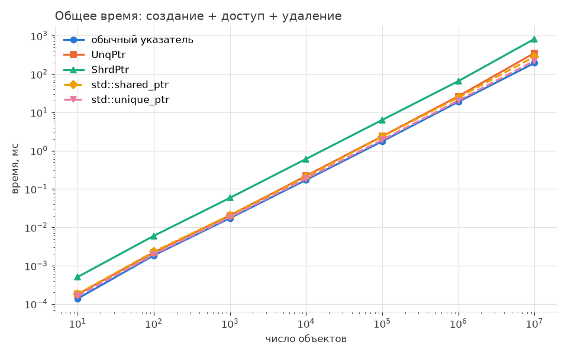
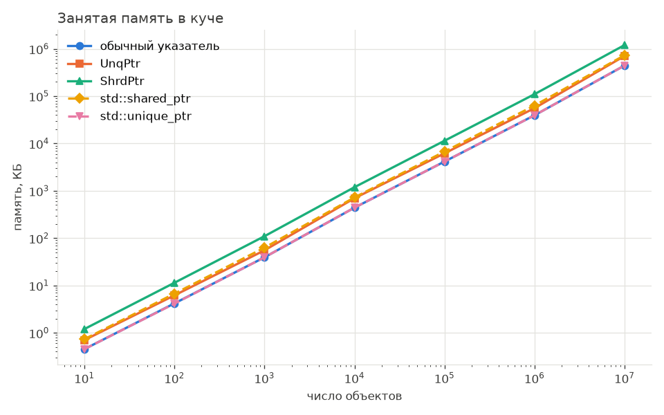
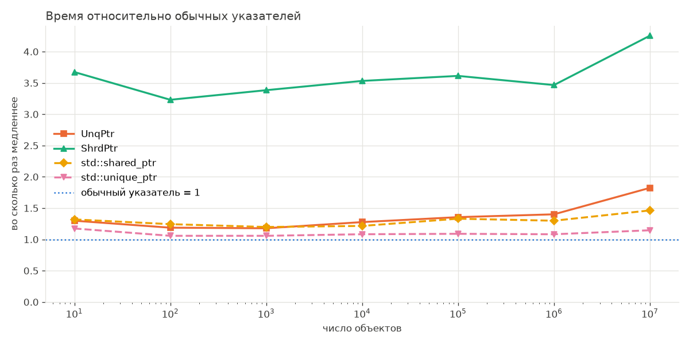
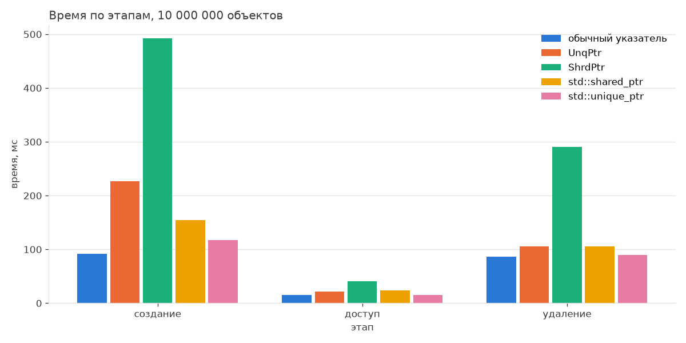

# ДЗ №1. Умные указатели

Вариант 2, децентрализованное хранение: `UnqPtr<T>` — ведущий указатель, `ShrdPtr<T>` — дескриптор, ссылки считает только `ShrdPtr` через `size_t* referenceCount`. Дополнительно сделаны `MemorySpan<T>` и `MsPtr<T>`, контейнер `DynamicArray<T>`, тесты, нагрузочные замеры с графиками и консольное меню. STL используется только для сравнения в бенчмарке.

## Структура

```
include/   UnqPtr, ShrdPtr, DynamicArray, MemorySpan, MsPtr (шаблоны) и заголовки модулей ниже
src/       main.cpp, Ui.cpp (меню), Console.cpp (рамки и цвета), Demo.cpp (демо),
           Benchmark.cpp (замеры), HeapCounter.cpp (подсчет памяти в куче)
tests/     по файлу на блок: UnqPtr, ShrdPtr, DynamicArray, MemorySpan, MsPtr;
           Tests.hpp/Tests.cpp — общие тестовые классы, запуск тестов с проверкой утечек
scripts/   plot.py — графики по results/results.csv
results/   results.csv и графики
```

## Запуск

Нужны `g++` с C++20, `make`, Python 3 с `matplotlib`, Linux (бенчмарк использует `malloc_usable_size` из glibc). Команды выполняются из корня проекта.

```
make                          # собирает одну программу build/app
./build/app                   # меню
./build/app tests             # только тесты (или make test)
./build/app benchmark [quick] # только замеры (или make benchmark)
make sanitize                 # тесты под AddressSanitizer и UBSan
```

Тесты и замеры — модули той же программы, а не отдельные программы, поэтому `main` один. В меню: демо каждого класса и все демо подряд, тесты, быстрый и полный нагрузочный тест, построение графиков. Вспомогательные списки (строки меню, размеры `N` в замерах) хранятся в нашем `DynamicArray`, `std::vector` не используется.

## Реализация

- **`UnqPtr<T>`** — единоличный владелец. Копирование запрещено (`= delete`), только перемещение. Хранит указатель на объект, исходный адрес и функцию удаления по настоящему типу, поэтому удаление через базовый класс корректно без виртуального деструктора, в том числе при множественном наследовании и при создании сразу из new. **`UnqPtr<T[]>`** — специализация для массивов с `operator[]` и `delete[]`.
- **`ShrdPtr<T>`** хранит только `UnqPtr<T>* master_` и `size_t* referenceCount_`, прямой ссылки на объект нет. Создается только из `UnqPtr&&` или копированием. Когда счетчик доходит до нуля, удаляется ведущий `UnqPtr`, а объект удаляет уже он, так что логика освобождения не дублируется.
- **Подтипизация**: конвертирующие конструкторы и присваивания ограничены `requires std::is_convertible_v<U*, T*>`, обратные и несвязанные преобразования не компилируются. При `ShrdPtr<Base> b = d;` создается новый ведущий `UnqPtr<Base>` с правильным адресом базы, который держит копию исходного дескриптора. Объект по-прежнему удаляется один раз, а у каждой группы свой счетчик: у `d` он становится 2, у `b` равен 1.
- **`DynamicArray<T>`** — массив на `UnqPtr<T[]>` с удвоением емкости и проверкой границ.
- **`MemorySpan<T>`** отдает элементы только через умные указатели: `Get` → `UnqPtr` с копией, `Copy` → `ShrdPtr` с копией, `Locate` → `MsPtr`.
- **`MsPtr<T>`** привязан к своему `MemorySpan`. Арифметика, сравнения и разыменование проверяют границы и бросают исключение, поэтому выйти за массив нельзя.

## Тесты

52 теста на assert, по файлу на блок: `UnqPtr` (16), `ShrdPtr` (13), `DynamicArray` (7), `MemorySpan` (7), `MsPtr` (9). После каждого теста проверяется, что живых объектов не осталось, так что утечку поймает любой тест. Покрыты перемещение, счетчик ссылок, самоприсваивание, пустые указатели, подтипизация (разрешенные и запрещенные преобразования проверяются `static_assert`), удаление без виртуального деструктора при множественном наследовании, выход за границы. Все тесты проходят и под AddressSanitizer и UBSan.

## Нагрузочное тестирование

`N` объектов по 16 байт создаются, кладутся в `DynamicArray`, читаются и удаляются. Сравниваются обычные указатели, `UnqPtr` с `std::unique_ptr` и `ShrdPtr` с `std::shared_ptr` (через `make_unique` и `make_shared`). `N` от 10 до 10⁷. На малых `N` замер повторяется до миллиона созданных объектов и усредняется, у каждого варианта берется лучший из 3 раундов. Память считается точно, через подмену `operator new` и `operator delete`: суммируются реальные размеры блоков в куче. Результаты ниже — запуск автора, g++ -O2; полные суммы лежат в `results/results.csv`. Два полных запуска расходятся по времени в среднем на 1 %, максимум на 20 % в отдельных точках; память совпадает до байта.

### Время на один объект (создание + доступ + удаление), нс

| N | обычный | UnqPtr | std::unique_ptr | ShrdPtr | std::shared_ptr |
|---|---|---|---|---|---|
| 10 | 13,7 | 17,8 | 16,1 | 50,4 | 18,1 |
| 100 | 18,5 | 22,0 | 19,6 | 59,8 | 23,0 |
| 1 000 | 17,3 | 20,4 | 18,3 | 58,5 | 20,7 |
| 10 000 | 17,2 | 21,9 | 18,6 | 60,7 | 20,9 |
| 100 000 | 17,5 | 23,7 | 19,1 | 63,2 | 23,3 |
| 1 000 000 | 18,8 | 26,3 | 20,3 | 65,2 | 24,4 |
| 10 000 000 | 19,4 | 35,3 | 22,2 | 82,4 | 28,3 |



### Память на один объект, байт

| Вариант | Блоки в куче | Сам указатель | Итого |
|---|---|---|---|
| обычный указатель | 32 (объект) | 8 | 40 |
| `UnqPtr` | 32 (объект) | 24 | 56 |
| `std::unique_ptr` | 32 (объект) | 8 | 40 |
| `ShrdPtr` | 96 (объект, ведущий `UnqPtr`, счетчик — по 32) | 16 | 112 |
| `std::shared_ptr` | 48 (объект и счетчик одним блоком) | 16 | 64 |

`malloc` выдает блок не меньше 32 байт, поэтому объект на 16 байт занимает 32. Итог не зависит от `N`. Измеренная память на всех `N` совпадает с формулой «`N` × итог + пустые ячейки запаса емкости массива» с точностью до нескольких килобайт заголовков. Полные значения есть на графике и в `results.csv`.







### Выводы

- **`std::unique_ptr`** почти бесплатен: память как у обычного указателя, время в 1,06–1,17 раза больше.
- **`UnqPtr`** против `std::unique_ptr`: памяти в 1,4 раза больше (56 байт на объект против 40: указатель 24 байта вместо 8), время в 1,1–1,6 раза больше, в основном на создании. Это цена удаления без виртуального деструктора: у `std::unique_ptr` удаление через базу без `virtual` — неопределенное поведение.
- **`ShrdPtr`** против `std::shared_ptr`: три аллокации вместо одной, поэтому памяти в 1,75 раза больше (112 байт против 64), время в 2,6–2,9 раза больше. Доступ на 10⁷ в 1,8 раза медленнее из-за двойной косвенности: дескриптор → `UnqPtr` → объект. Это следствие требования ссылаться только на `UnqPtr`.
- **Относительно обычных указателей**: `ShrdPtr` в 2,8 раза тяжелее и в 3,2–4,3 раза медленнее, `std::shared_ptr` в 1,6 раза тяжелее и в 1,2–1,5 раза медленнее.
- **Рост с `N` почти линейный**: стоимость одного объекта от 10 до 10⁶ почти не меняется (у обычного указателя 14–19 нс), на 10⁷ немного растет у всех. На малых `N` соотношения те же, что и на больших.
- **Утечек нет**: тесты и санитайзеры это подтверждают.

## Соответствие условию

| Требование | Где |
|---|---|
| `UnqPtr`, `ShrdPtr` по варианту 2, `UnqPtr` не копируется | `include/UnqPtr.hpp`, `include/ShrdPtr.hpp` |
| `ShrdPtr` ссылается только на `UnqPtr`, счетчик `size_t*` | поля `master_`, `referenceCount_` |
| Подтипизация `C1 ⊆ C2`, иначе ошибка компиляции | `requires`, `static_assert` в тестах |
| `MemorySpan` (`Get`, `Copy`, `Locate`) и `MsPtr` | `include/MemorySpan.hpp`, `include/MsPtr.hpp` |
| Контейнер на умных указателях | `include/DynamicArray.hpp` |
| Функциональные тесты, отсутствие утечек | `tests/`, `make sanitize` |
| Нагрузочные тесты: малые и большие `N`, время и память, сравнение без умных указателей и с STL | `src/Benchmark.cpp`, `src/HeapCounter.cpp` |
| Таблицы и графики | этот файл, `results/` |
| Интерфейс | `src/Ui.cpp`, `src/Demo.cpp` |
